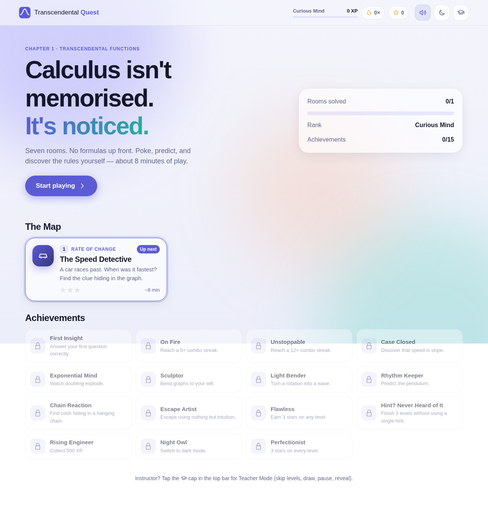
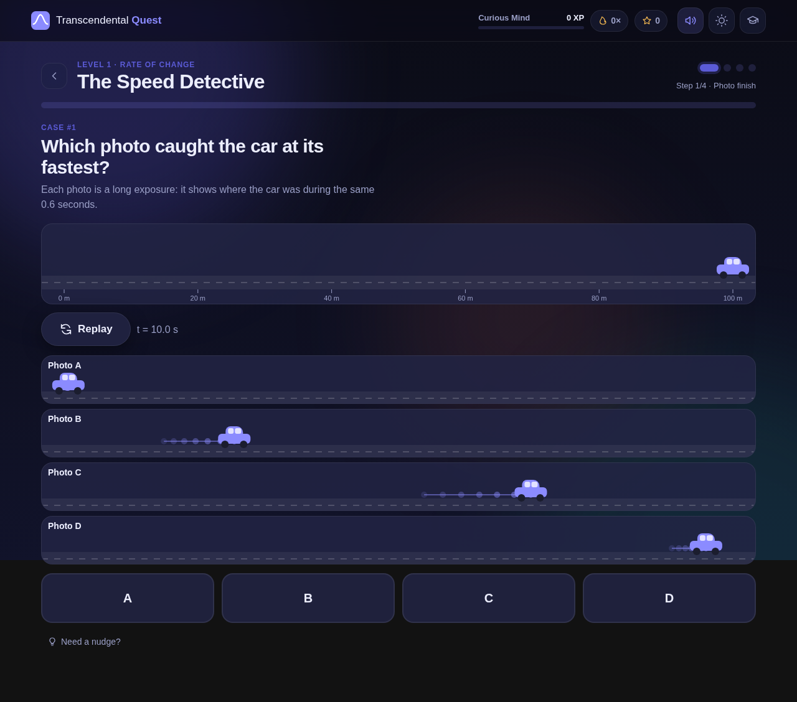
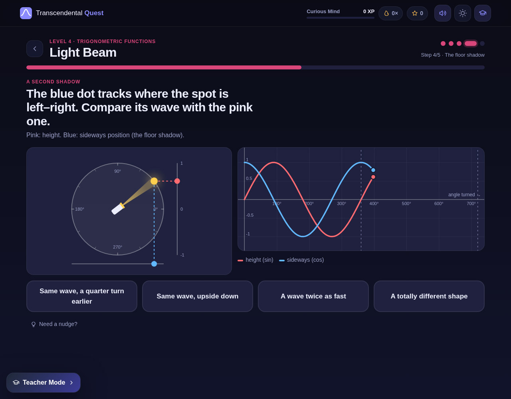
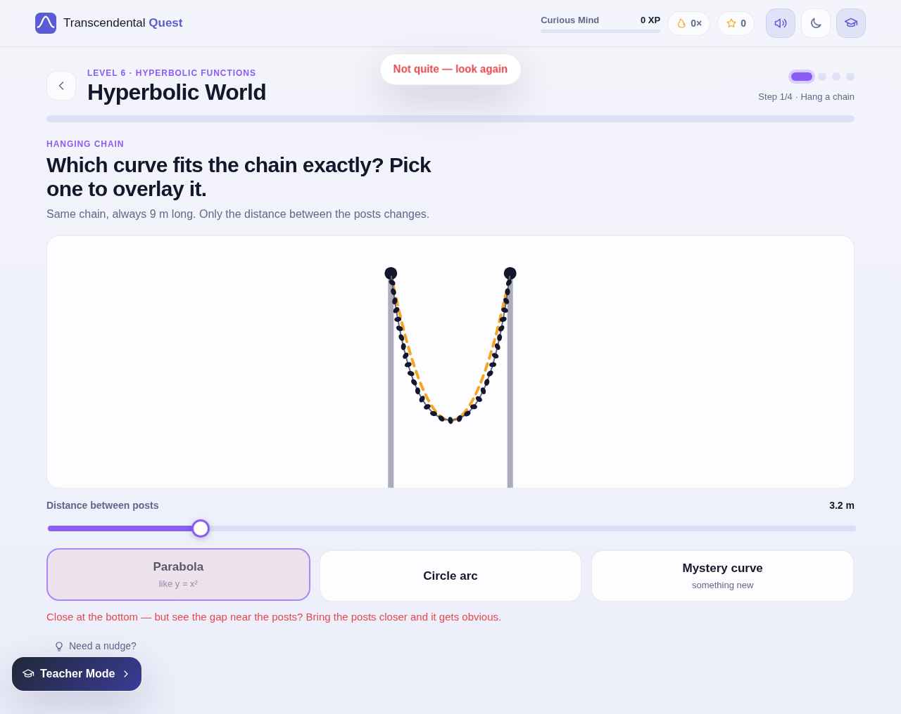
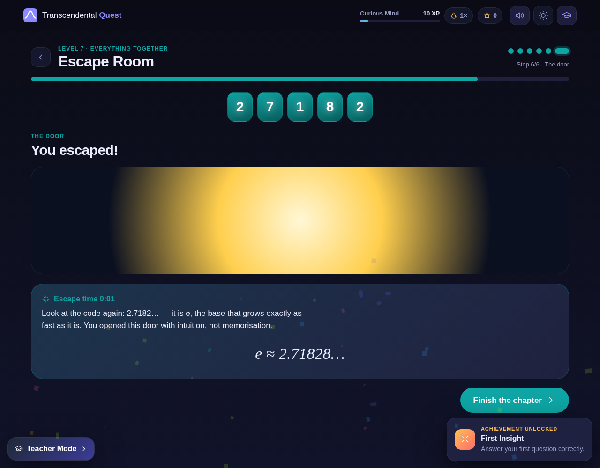

# Transcendental Quest

**An interactive game that teaches first-year engineering students the ideas behind transcendental functions by letting them work out the rules for themselves.**

No login. No backend. No formulas up front. There are seven levels and about an hour of play, and each one follows the same loop:
**predict → try → notice → then name it.**

**▶ [Play it in your browser](https://nouranelsaraf.github.io/Transce-functions/)**



## Levels

| # | Level | Topic | What you actually do |
|---|---|---|---|
| 1 | **The Speed Detective** | Rate of change | Compare long-exposure photos of a car, drag a tangent to find the fastest moment, and shrink a secant until the derivative appears |
| 2 | **Growing Kingdom** | Exponentials | Watch a granary double each morning, guess the amount for day 7 and day 30, race a linear neighbour, then find *e* with one slider |
| 3 | **Graph Sculptor** | Graph intuition | Match ghost curves with plain-language controls. The equation `y = a·f(bx + c) + k` only appears once you have matched them |
| 4 | **Light Beam** | Trig functions | Aim a spinning flashlight and see that the height of its spot draws sine, its floor shadow draws cosine, and the wave repeats every 360° |
| 5 | **The Swing** | Periodic motion | Predict where a pendulum will be, recognise its path as a cosine, find that rope length matters and amplitude doesn't, and forecast t = 7.5 s |
| 6 | **Hyperbolic World** | Hyperbolic functions | Hang a chain and compare it with a parabola and a circle, build cosh from eˣ and e⁻ˣ, and compare the circle with the hyperbola |
| 7 | **Escape Room** | Everything | Open five locks using only what you have learned so far, then enter the door code (it turns out to be *e*) |

A full, automatically generated guide to every step is in [docs/LEVELS.md](docs/LEVELS.md).

| | |
|---|---|
|  |  |
|  |  |

## Features

- **Discovery first.** Explanations are at most 2–3 sentences and always come *after* an interaction. Wrong answers explain *why* they're tempting.
- **Small wins everywhere.** Every level shows step dots, a progress bar and mini-checklists, so there's always a visible next goal.
- **Gamification.** XP, a combo streak that pays bonus XP, 1–3 stars per level (hints and slips cost stars), 7 ranks, 15 achievements, confetti and instant feedback.
- **Polish.** Glassmorphism UI, light and dark mode, smooth motion (honours `prefers-reduced-motion`), synthesised sound effects with a mute toggle, and a responsive layout down to phone width.
- **Accessible input.** Every drag-on-canvas interaction also has a slider, so the whole game works with a keyboard.
- **Progress saves locally** (`localStorage`). Nothing ever leaves the browser.

### Lesson companion (اشرحها بالمصري)

This layer sits on top of every level without changing any of the game mechanics:

| Feature | What students get |
|---|---|
| **🇪🇬 اشرحها بالمصري** | A toggle (on the map and in every lesson). Each step gets an explanation in Egyptian Arabic, written the way an older sibling would explain it. Before you solve the step it only sets up the problem, so it never gives the answer away; after you solve it, it explains why it works. All the companion content below also switches to Arabic. |
| **Observe → Predict → Interact → Reveal** | A discovery strip and an "Ask yourself" question at the top of every step, *before* any explanation ("What changed?", "Can you predict…?"). |
| **Real life before the formula** | Every formula is preceded by *Why do we need this?*, one everyday example and one engineering example, so the equation reads as a conclusion. A test checks that no formula appears without them. |
| **🌍 فين بنشوف ده في الحقيقة؟** | A button in every lesson with three short real-world applications. |
| **👷 المهندس بيستخدم ده فين؟** | A button in every lesson with three engineering uses (civil, electrical, mechanical…). |
| **⚠️ Common mistakes** | The end-of-lesson screen lists the 3 most common student mistakes and why each one is wrong. |

The content lives in `src/levels/<Level>/lesson.js` (plain data, English and Arabic), and is also published in [docs/LEVELS.md](docs/LEVELS.md).

### Teacher Mode

Tap the 🎓 cap in the top bar (or press **Shift + T**):

| Tool | What it does |
|---|---|
| **Pause** | Freezes every animation in the app (shortcut **P**) so you can talk over a frozen frame |
| **Draw** | Ink overlay on top of anything, with 6 colours. **Clear ink** wipes it |
| **Reveal** | Shows each step's explanation immediately and adds a *Skip step* button |
| **Next step / Skip level** | Jump ahead during a lecture. You can also click the step dots to jump to any step |
| **Unlocks all levels** | The whole map is playable while Teacher Mode is on |
| **Reset all** | Clears XP, stars and achievements (it asks you to confirm) |

## Quick start

```bash
npm install
npm run dev          # http://localhost:5173
```

| Command | Purpose |
|---|---|
| `npm run dev` | Development server with hot reload |
| `npm test` | Unit and render tests (Vitest + jsdom) |
| `npm run build` | Regenerates the docs, then builds a static site into `dist/` |
| `npm run preview` | Serves the production build |
| `npm run docs` | Regenerates `docs/MODULES.md` and `docs/LEVELS.md` from the source |
| `npm run docs:check` | Fails if the generated docs are stale (used in CI) |

The build uses relative paths, so you can put `dist/` on any static host or open it from a local server in a lab with no internet.

## Project structure

```
src/
  core/        pure game logic: reducer, scoring, achievements, maths, sound, confetti
  hooks/       animation loop (respects Teacher pause), theme colours, element size
  components/  UI kit: Plot, Stage, StepLayout, Choices, Slider, TeacherPanel, …
  levels/      one folder per level: meta.js + one component per step
  screens/     Home (map) and LevelScreen (step runner)
  styles/      design tokens, base, components, screens, level styles
scripts/       documentation generator
tests/         Vitest suites
docs/          generated docs + screenshots
```

For the architecture, design principles and roadmap, see **[PROJECT.md](PROJECT.md)**. For a reference of every module, see [docs/MODULES.md](docs/MODULES.md).

### Adding a level

1. Create `src/levels/MyLevel/meta.js` (id, title, topic, steps, …). The docs generator reads it.
   Add `lesson.js` too (Masry explanations, real-life bridges, reality/engineering uses, misconceptions) and register it in `src/lesson/registry.js`.
2. Write one component per step. Each receives an `api` (`answer`, `hint`, `complete`, `reveal`, `paused`). Wrap it in `<StepLayout>` so it gets hints, the insight card and the Continue button.
3. Export `{ meta, steps }` from `index.jsx`, and register it in `levels/registry.js` and `levels/metaRegistry.js`.
4. Run `npm test`. The render tests mount every step automatically.

## Documentation is generated

`scripts/generate-docs.mjs` rebuilds the module reference from each file's `@module` JSDoc header, and the level guide from each level's `meta.js`. It runs on every `npm run build`, and CI fails if the committed docs are out of date, so the documentation keeps up with the code.

## License

MIT
